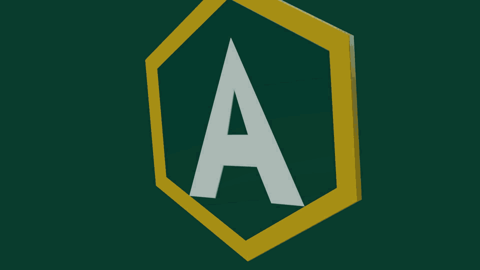
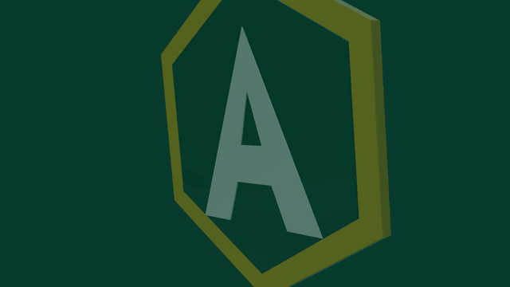
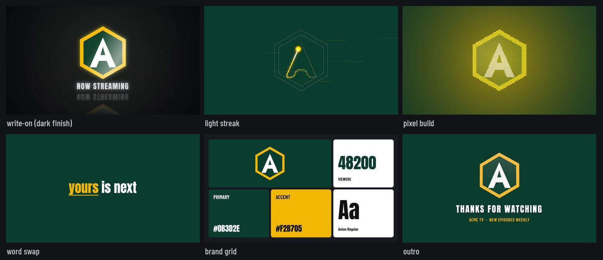
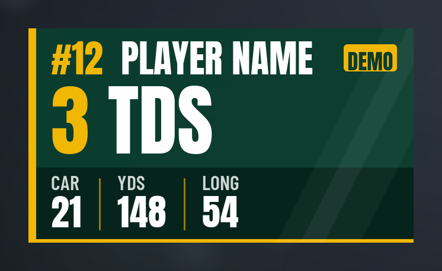
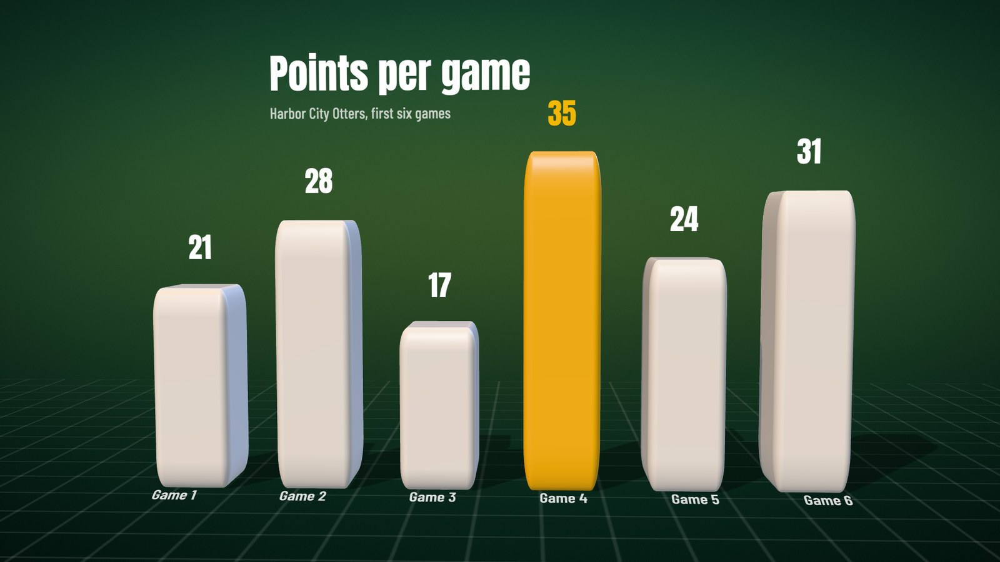
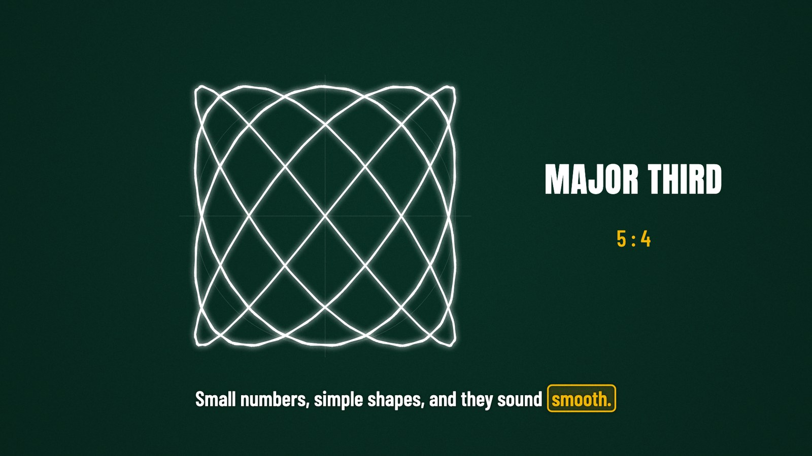
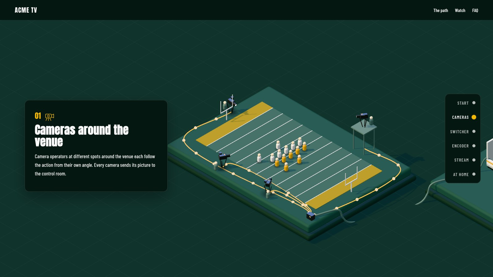
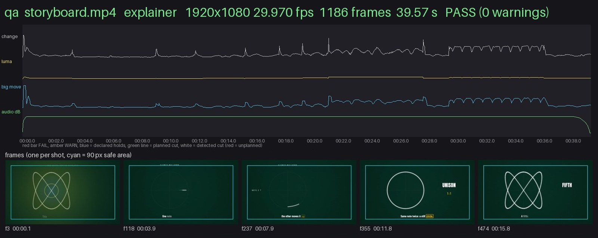

# Stealth Goat video engines

One local engine for branded video, plus a small web kit: logo animations, lower thirds, explainers, 3D data
scenes, edits, one-page websites, and a QA gate (`engine/qa.py`) you run on any render. It writes a pass/fail verdict
and a review sheet before anyone else sees the piece.

It is for small video teams, creators, agencies and developers who want motion graphics and edits that are
scriptable and repeatable on a Mac, driven by Claude or by plain Python commands. Stealth Goat is the maintainer's
brand (GitHub: [thestealthgoat](https://github.com/thestealthgoat)).

**Status:** early release, macOS on Apple silicon only. What changed and when: [`CHANGELOG.md`](CHANGELOG.md).

[](LICENSE)
[-lightgrey.svg)](#requirements)
[](#requirements)
[](#use-it-with-claude)



<sub>Slow connection? Here is the [still version](docs/images/hero.jpg).</sub>

Python + ffmpeg + headless Chromium, free and open-source tools only. Brand colors, fonts, logos, folders and
delivery specs live in a **profile**, so the same tools render for any team, club or business. Every example here
uses the neutral `demo` profile and made-up names (ACME, Jane Doe, the Harbor City Otters).

## Contents

- [What you can make](#what-you-can-make)
- [Use it with Claude](#use-it-with-claude)
- [Quick start without Claude](#quick-start-without-claude)
- [Bring your own brand](#bring-your-own-brand)
- [How it works](#how-it-works)
- [Repository map](#repository-map)
- [Documentation](#documentation)
- [Requirements](#requirements)
- [Getting help](#getting-help)
- [Contributing](#contributing)
- [License](#license)

## What you can make

Run each command from the engine folder. `logo.svg` stands for your own SVG logo; the other inputs ship with the
repo. To try the logo commands now, use the bundled sample mark instead:
`plugins/video-engine/skills/logo-motion/assets/acme_mark.svg` in place of `logo.svg`.

<table>
  <tr>
    <td width="50%"></td>
    <td width="50%"></td>
  </tr>
  <tr>
    <td><b>Logo intros</b> with alpha (ProRes 4444 + MP4 preview):<br><code>python3 logo/motion.py logo.svg out/logo ACME intro --profile demo</code></td>
    <td><b>Logo templates</b>: write-on, light streak, pixel build, word swap, brand grid, end card and more:<br><code>python3 logo/motion.py logo.svg out/logo ACME writeon --profile demo</code></td>
  </tr>
  <tr>
    <td></td>
    <td></td>
  </tr>
  <tr>
    <td><b>Stats lower thirds</b> from a small JSON file:<br><code>python3 engine/statcard.py docs/stats_card_example.json out/first --profile demo --name demo_card</code></td>
    <td><b>3D data scenes</b> (three.js, rendered frame by frame):<br><code>python3 engine/stage3d.py data out/stage3d Otters --data examples/stage3d/sample_data.json --profile demo --fps 29.97</code></td>
  </tr>
  <tr>
    <td></td>
    <td></td>
  </tr>
  <tr>
    <td><b>Explainers</b> whose numbers are computed, not guessed (two stills, after <code>python3 examples/explain/lissajous/make.py</code>):<br><code>python3 engine/explain.py examples/explain/lissajous/storyboard.json --out out/lissajous --profile demo --frames 2.0,12.0</code></td>
    <td><b>One-page websites</b> from a short <code>site.json</code>, checked by a compliance gate (legal pages are drafts to review, not legal advice):<br><code>python3 web/build.py examples/sites/demo-world/site.json --out out/sites/demo-world --profile demo</code></td>
  </tr>
  <tr>
    <td colspan="2"></td>
  </tr>
  <tr>
    <td colspan="2"><b>A QA review sheet</b> for any render you check: verdict, gate table, one frame per shot, fix lines with frame numbers:<br><code>python3 engine/qa.py out/lissajous/storyboard.mp4 --profile demo --kind explainer --out out/lissajous/qa</code></td>
  </tr>
</table>

Also in the box (each links to its entry in the [tool reference](docs/TOOLS.md)):

- [Talking-head edits](docs/TOOLS.md#talkeditpy) that cut the pauses, in 16:9 and 9:16
- [Kinetic captions](docs/TOOLS.md#captionspy) that spring in word by word
- [Person mattes](docs/TOOLS.md#mattepy) and [text behind the speaker](docs/TOOLS.md#behindpy)
- [Beat maps](docs/TOOLS.md#beatmappy) and [beat-synced cuts](docs/TOOLS.md#beatsnappy)
- [Contact sheets](docs/TOOLS.md#sheetpy) for review
- [Premiere-ready XML](docs/TOOLS.md#fcp7xmlpy) from an edit list
- [9:16 verticals](docs/TOOLS.md#verticalpy) of a finished 16:9 piece
- [Logo vectorizing](docs/TOOLS.md#vectorizepy) and [3D extrusion](docs/TOOLS.md#render3dpy)
- [Background-removed person cutouts](docs/TOOLS.md#cutoutspy) from photos
- [Stop-motion packs](docs/TOOLS.md#flipbookpy) from burst photos

## Use it with Claude

The repo is also a Claude plugin marketplace with two plugins.

**video-engine** (12 skills)

| Skill | What it does |
|---|---|
| `getting-started` | clones and sets up the engine, makes your brand profile, gives a ten-minute tour |
| `video` | front door for any edit: cut pauses, captions, beat sync, verticals |
| `video-gates` | runs the QA gate on a render and reads the review sheet with you |
| `explain` | explainers built from a storyboard, with computed visuals |
| `matte` | person mattes, text behind the speaker |
| `motion-graphics` | stats lower thirds, quote cards, progress bars, before/after, route maps, 3D card scenes |
| `logo-motion` | logo intros, end cards, corner bugs, stingers, word swaps, shatter transitions |
| `logo-3d` | 3D versions of a logo: stills, swing loops, GLB |
| `logo-vectorize` | a raster logo (JPG, PNG, screenshot) to a clean SVG |
| `player-cutouts` | transparent person cutouts from photos, filed per person |
| `action-pack` | stop-motion packs from burst photos |
| `reference-intake` | breaks down a video you like into a reusable recipe |

**ui-kit** (2 skills)

| Skill | What it does |
|---|---|
| `ui-kit` | brand color tokens with measured contrast, spring UI motion, accessible components |
| `website` | one-page sites from `site.json`, with draft legal pages to review, consent and a compliance gate |

**Install in Claude Code:**

```text
/plugin marketplace add thestealthgoat/stealth-goat-video-engines
/plugin install video-engine@stealth-goat
/plugin install ui-kit@stealth-goat
```

**Install in the Claude desktop app:** download
[`video-engine.plugin`](https://github.com/thestealthgoat/stealth-goat-video-engines/raw/main/plugins/dist/video-engine.plugin)
and
[`ui-kit.plugin`](https://github.com/thestealthgoat/stealth-goat-video-engines/raw/main/plugins/dist/ui-kit.plugin),
then open each one in the Claude desktop app and press Install.

Then say **"set up the video engine"**. The `getting-started` skill first asks whether you already have the engine
somewhere; if not, it clones it to `~/video-engine` (or a folder you name). It runs `setup.sh` (asking before it
installs anything), points `VIDEO_ENGINE` at that folder, helps you make a brand profile and renders a short tour.

## Quick start without Claude

macOS on Apple silicon with [Homebrew](https://brew.sh).

```bash
git clone https://github.com/thestealthgoat/stealth-goat-video-engines.git ~/video-engine && cd ~/video-engine
export VIDEO_ENGINE="$HOME/video-engine"   # the engine folder (add this line to ~/.zprofile too)
./setup.sh                          # installs what is missing, then checks (safe to run again)
./setup.sh --check --profile demo   # installs nothing; ends with "== Result: 0 missing, N warnings"
```

`setup.sh` never edits your shell files; it prints the lines to add to `~/.zprofile`. What it installs, its flags
and the common warnings: [Getting started](docs/GETTING_STARTED.md#setup-details).

A first render on the demo profile, a stats lower third from the sample file in `docs/`:

```bash
python3 engine/statcard.py docs/stats_card_example.json out/first --profile demo --name demo_card
```

That writes `out/first/demo_card_stats_Alpha.mov` (ProRes 4444 with alpha, for an editor),
`demo_card_stats.mp4` (preview) and `demo_card_stats.png` (still). Now QA it. A lower third is an overlay, so it is
checked as a loop with no planned cuts:

```bash
python3 engine/qa.py out/first/demo_card_stats.mp4 --profile demo --kind loop --cuts none --out out/first/qa
```

It should end `RESULT: PASS (0 warnings)`. Open `out/first/qa/review.md` and `out/first/qa/sheet.jpg`.

More to try, each with its exact commands, in [`examples/README.md`](examples/README.md): the Lissajous explainer,
the 3D data scene and two demo websites.

## Bring your own brand

A profile is one JSON file, `profiles/<name>/profile.json`, copied from `profiles/_template/profile.json`. Make one
from your colors, two OFL fonts and an SVG logo:

```bash
python3 engine/vprofile.py new acme --display "ACME Studio" --primary "#123456" --accent "#E04050" \
    --head-font resources/fonts/BebasNeue-Regular.ttf --body-font resources/fonts/BarlowCondensed-SemiBold.ttf \
    --logo path/to/acme-logo.svg --sample
mkdir -p ~/Movies/video-work/Assets/Music        # the working folders a new profile points at
python3 engine/vprofile.py show acme --check     # fonts, logo and folders found: ends CHECK: OK
python3 engine/vprofile.py default acme          # this machine's default (writes local.json, not committed)
```

Without the `mkdir`, the check ends `CHECK: missing` and names each working folder it could not find; create them,
or point `paths.root` in the profile somewhere else.

`new` copies the fonts and logo into `profiles/acme/assets/`, and `--sample` writes `profiles/acme/sample_card.png`,
a brand card that shows each color's contrast and each font role. Each font's OFL license text is copied beside it
when one is found next to the font or in `resources/fonts/` (the website gate fails a font without one).
Then fill in what the flags do not cover (text color, frame rate, loudness target, working folders).

Which profile a tool uses: `--profile <name>`, else `$VIDEO_PROFILE`, else `local.json`. Every key, and how to read
a profile from your own tool, is in [`docs/LAYOUT.md`](docs/LAYOUT.md).

## How it works

- **Springs, not easing curves.** Everything that moves uses closed-form damped springs (`engine/spring.py`,
  `engine/spring.js`). Each frame is a pure function of time, so any frame renders on its own and the same time gives
  the same picture. Presets and the math: [`engine/README_motion.md`](engine/README_motion.md).
- **A QA gate you run on any render.** `engine/qa.py` checks spec, dead stretches and stutters, hard audio cuts,
  loudness and true peak, unplanned cuts, flash frames, clicks, the opening hook and end holds. Each problem is
  written as a fix line with frame numbers, and the run writes `review.md` and a review sheet. The Claude skills run
  it before they hand a render over.
- **Profiles.** No organization's paths, colors, fonts or names are in the code. Tools ask the profile.
- **A local engine, no tracking.** Renders run on your machine and the engine uploads nothing. Its only network use
  is first-use downloads (open models for cutouts and transcripts, Natural Earth map data) and the optional
  OpenStreetMap query in `engine/routemap.py --map osm`. Sites built with `web/build.py` load no analytics by default.
  If you use the Claude plugins, your prompts and anything you share in the conversation go to Claude, as in any
  Claude conversation.
- **Source is read-only.** Tools write to the output folder you give them, never over your footage.

## Repository map

| Folder | What is in it |
|---|---|
| `engine/` | the core tools: QA gate, springs, statcard, stage3d, explain, talkedit, captions, matte, beat map, encode, profile loader (`vprofile.py`) |
| `logo/` | logo vectorize and redraw, 3D extrusion, animated logo templates with alpha |
| `cutouts/` | person cutouts from photos, graded and filed per person |
| `web/` | the website kit: `build.py`, the compliance gate, previews, five templates |
| `examples/` | ready-made inputs for the demo profile: an explainer, a 3D data scene, two websites |
| `plugins/` | the `video-engine` and `ui-kit` Claude plugins; packaged `.plugin` files in `plugins/dist/` |
| `profiles/` | `_template` (copy source) and `demo` (OFL fonts with their licenses, a sample logo) |
| `resources/fonts/` | open-license fonts with their OFL texts |
| `skills/video-gates/` | the QA checklist that `engine/qa.py` implements (the plugin's `video-gates` skill wraps it) |
| `vendor/` | third-party code kept unchanged, with its license |
| `tests/` | self-tests on synthetic input |
| `docs/` | guides, the profile API, ffmpeg notes, the images in this README |

## Documentation

| Document | Read it for |
|---|---|
| [`docs/GETTING_STARTED.md`](docs/GETTING_STARTED.md) | setup step by step, and your first renders |
| [`docs/TOOLS.md`](docs/TOOLS.md) | every tool, what it takes and what it writes |
| [`docs/LAYOUT.md`](docs/LAYOUT.md) | profiles and the profile API, for tool authors |
| [`engine/README_motion.md`](engine/README_motion.md) | springs, the motion gate, beat maps |
| [`logo/README.md`](logo/README.md) | the logo tools |
| [`cutouts/README.md`](cutouts/README.md) | person cutouts |
| [`examples/README.md`](examples/README.md) | the examples and their exact commands |
| [`plugins/video-engine/README.md`](plugins/video-engine/README.md) | the video-engine plugin |
| [`plugins/ui-kit/README.md`](plugins/ui-kit/README.md) | the ui-kit plugin and the website kit |
| [`docs/ffmpeg-notes.md`](docs/ffmpeg-notes.md) | ffmpeg traps: `-nostdin`, bounded `apad` |
| [`CHANGELOG.md`](CHANGELOG.md) | what changed in each release |
| [`NOTICE.md`](NOTICE.md) | third-party code and data credits |

## Requirements

- macOS on Apple silicon, with Homebrew. `setup.sh` targets this; the engine is Python + ffmpeg, so other systems
  may work by hand but are untested.
- Python 3.10 or newer (tested on 3.14). Packages: [`requirements.txt`](requirements.txt).
- Homebrew: `ffmpeg` (native arm64, `/opt/homebrew/bin` first in `PATH`), `imagemagick`, `tesseract`, `node`, `cairo`.
- Playwright Chromium for the logo, 3D and website renders (installed by `logo/setup.sh`).
- Known setup traps and their fixes: [Getting started, troubleshooting](docs/GETTING_STARTED.md#9-troubleshooting).

Run the self-tests:

```bash
for t in tests/test_*.py; do python3 "$t" || echo "FAILED: $t"; done
```

## Getting help

- **Bugs and feature ideas:** open an [issue](https://github.com/thestealthgoat/stealth-goat-video-engines/issues);
  the bug report and feature request templates ask for what is needed to reproduce it.
- **Setup problems:** see [Getting started, troubleshooting](docs/GETTING_STARTED.md#9-troubleshooting), and run
  `./setup.sh --check` again after each fix.
- **Security issues:** please report them privately, as described in [`SECURITY.md`](SECURITY.md), not in a public
  issue.

## Contributing

Issues and pull requests are welcome. See [`CONTRIBUTING.md`](CONTRIBUTING.md) for how to set up, run the tests and
keep tools profile-driven.

## License

MIT, see [`LICENSE`](LICENSE). Third-party code and data credits are in [`NOTICE.md`](NOTICE.md). The fonts in
`resources/fonts/` and `profiles/demo/assets/` are under the SIL Open Font License, with each license text beside
its font.
